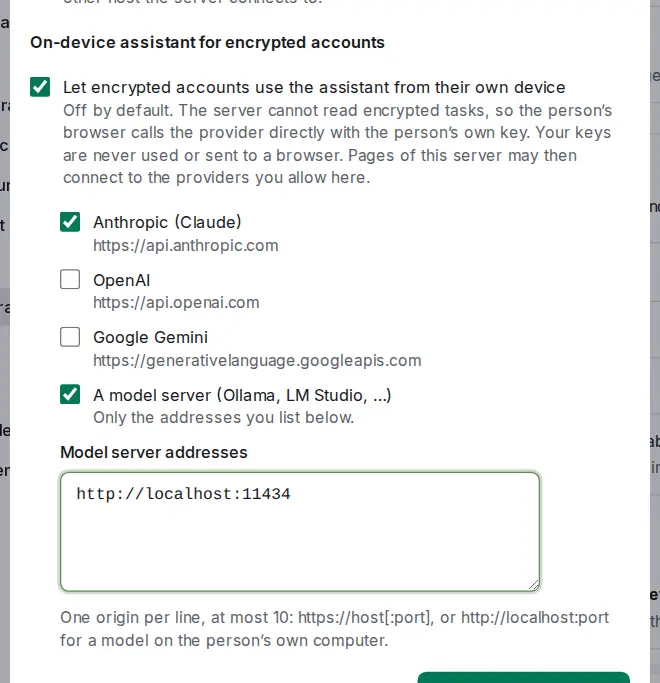

# Assistant on encrypted accounts

<picture><source srcset="images/assistant-device-owner-dark.webp" media="(prefers-color-scheme: dark)"></picture>

With [end-to-end encryption](e2ee.md) on, the server holds no key to your tasks, so it never runs the assistant for you. If the server owner allows it, the assistant runs **on your device** instead: your browser, which already holds the key, reads your tasks there and sends what a question needs **directly to the provider you choose, with your own key**. The OpenTodo server sees none of it.

## Set it up on a device

1. Open the assistant (<kbd>Shift</kbd>+<kbd>I</kbd>). The panel asks you to **set up the assistant on this device**.
2. Choose a provider the owner allows (Anthropic, OpenAI, Google Gemini, or a model server such as Ollama or LM Studio at an address the owner listed), a model, and paste your API key (optional for a model server). **Test connection** sends one request from this device.
3. Select **Save on this device**, read what is sent and select **Accept and continue**.

Proposals, review, undo, skills and pasted notes work as on the server. On the device the assistant cannot set custom field values, repeat rules, locations or origins. A locked device asks you to unlock it first.

## Your key and your usage

- **Your key stays in this browser.** It is never synced, never sent to the OpenTodo server, and deleted when you sign out. Like any page that calls a provider itself, the app's page can read it. Each device is set up on its own; change or remove it in **Settings → Integrations → Assistant → On this device**.
- **No connection to the server needed.** With a model server on the same computer, the assistant also answers while the OpenTodo server is unreachable.
- **Usage stays on the device.** Each answer shows its tokens with "your key"; nothing is reported, and the owner's monthly allowance does not apply.

## Providers and browsers

Anthropic accepts requests from a browser (OpenTodo sends its `anthropic-dangerous-direct-browser-access` header), and OpenAI's API does too; Google's endpoint is expected to, and **Test connection** tells you. Ollama needs `OLLAMA_ORIGINS` set to the app's address, and LM Studio its CORS switch on; your browser may ask before a page reaches `localhost`. If a request is blocked right after the owner allowed a provider, reload the page.

## For the server owner

**Settings → Integrations → Assistant → Configure → Let encrypted accounts use the assistant from their own device** is off by default. Tick the providers devices may call; for **A model server**, list up to 10 addresses, one origin per line: `https://host[:port]`, or `http://localhost:port` (also `127.0.0.1` and `[::1]`) for a model on the person's own computer. It needs the assistant's main switch but no provider or key of yours, and your keys are never used for it.

While it is on, every page of the server may connect to the allowed providers: the page's Content-Security-Policy (`connect-src`) gains exactly their origins, never a wildcard, and none when it is off. The installed app picks up the change on its next page load. It is always off on the public demo.
