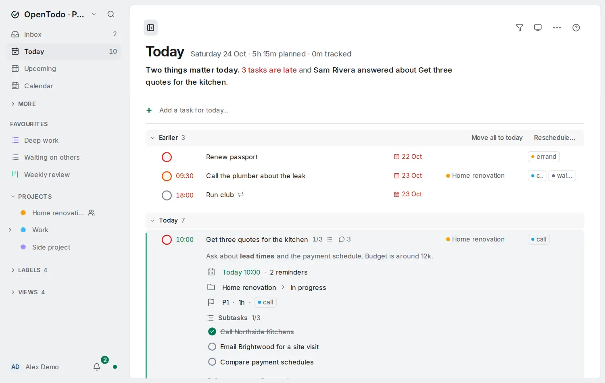

# Expand a row

<picture><source srcset="images/expand-a-row-dark.webp" media="(prefers-color-scheme: dark)"></picture>

Every task in a list is one line. To read the rest without leaving the list, expand its row: the details open under the title, and the list stays where it was.

## Open and close the details

- **Keyboard:** select the task (<kbd>j</kbd> / <kbd>k</kbd>) and press <kbd>→</kbd>. <kbd>←</kbd> or <kbd>Esc</kbd> closes them again.
- **Mouse:** point at the row and choose **Show details**, the first of the actions at its end.
- **Phone or narrow window:** tap the small arrow at the end of the row; tap it again to close.

On a task whose subtasks are folded in a project, the first <kbd>→</kbd> unfolds them and the second shows the details; <kbd>←</kbd> works the other way round.

## What they show

- The notes, about four lines, with **Show more** for the rest.
- When it is planned: the date, evening, repeat, deadline, start and reminders.
- Where it is: the project and section, the parent task, where it came from and its place.
- How: the priority (above P4), the estimate and the labels.
- Who: the person it is assigned to, the tasks it waits for and the ones waiting for it.
- The subtasks with their checkboxes, unless the list already shows them under the task.
- How many comments and attachments it has, and **Open task**.

The words are the same as on the task page.

## What you can change there

Tick a subtask to complete it, as on the task page; it works offline and syncs like any change. Everything else is read only: press <kbd>Enter</kbd> or **Open task** to change it, or <kbd>F2</kbd> to edit the title in place.

## Good to know

- One row is expanded at a time: expanding another closes the first. Moving the selection does not close it.
- It is not remembered: leaving the list or reloading closes it, and nothing is saved or synced.
- Rows expand in the Inbox, Today, Upcoming, Anytime, Someday, Completed, Assigned to me, projects, labels, places and views. Boards, the calendar, the timeline, the review screens and dashboards do not.
- While you drag a task, no row shows its details.

See also [Work from the list](work-from-the-list.md) and the [keyboard shortcuts](keyboard.md).
